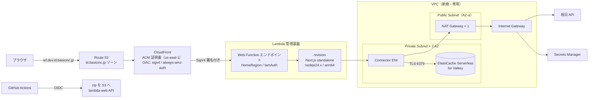
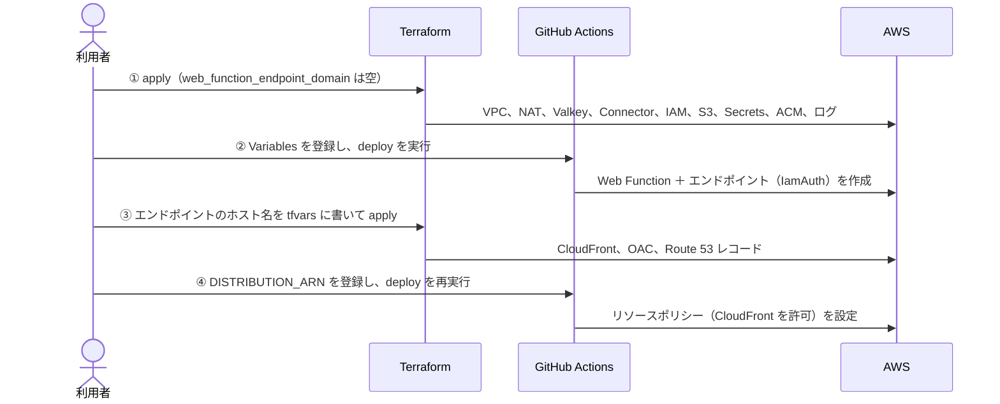

# Lambda Web Functions 検証プロジェクト 設計書

- 作成日: 2026-10-15
- 更新日: 2026-10-16
- ステータス: 構築済み（2026-10-16 に CloudFront 経由での動作を確認）
- 関連: [ネットワーク構成の選択肢](./network-options.md)

## 1. 概要

Next.js（App Router）で作る TODO アプリを題材に、Lambda Web Functions（2026-10-12 GA）を**本番稼働に近い構成**で検証する。データは VPC 内の ElastiCache Serverless for Valkey に保存し、CloudFront と独自ドメインから配信する。

### 1.1 検証の目的

- 本番に近いネットワーク構成（CloudFront → Web Functions → Network Connector → VPC 内の Valkey、NAT Gateway 経由の外部通信）が組めることを確かめる
- 次の 3 点を計測する
  - **コールドスタート**
  - **レイテンシ**
  - **負荷試験**（スループットとスケーリングの挙動）
- Terraform（インフラ）と GitHub Actions（アプリのデプロイ）の役割分担を確立する

### 1.2 スコープ外

- ユーザー認証と、ユーザーごとの TODO 分離（全員で 1 つのリストを共有する）
- WAF、アラーム、費用アラート、過剰アクセス対策（レート制限など）
- 冗長化（NAT Gateway は 1 台）、マルチリージョン
- 複数環境（環境は 1 つだけ）

## 2. 要件（決定事項）

| # | 項目 | 決定内容 |
| --- | --- | --- |
| 1 | リージョン | ap-northeast-1（東京） |
| 2 | 公開範囲 | 外部から誰でもアクセスできる（アプリの認証なし） |
| 3 | 入口 | CloudFront ＋ 独自ドメイン `wf.dev.id.basicinc.jp`。WAF は使わない |
| 4 | Web Function のエンドポイント | `IamAuth`。CloudFront の OAC からだけ呼び出せるようにし、直接アクセスは拒否する |
| 5 | データストア | ElastiCache Serverless for Valkey。VPC の Private Subnet に置き、外部からは到達できない |
| 6 | VPC 接続 | Network Connector |
| 7 | 外部通信 | NAT Gateway 経由。**1 台のみ**（冗長化しない） |
| 8 | 外部通信の題材 | アプリに外部 API（祝日 API）を呼ぶ機能を追加する。秘密情報の取得（Secrets Manager）も NAT 経由になる |
| 9 | 環境 | 1 つだけ |
| 10 | Valkey の認証 | Valkey のユーザー（RBAC）とパスワード。パスワードは Secrets Manager に置き、起動時に取得する |
| 11 | Valkey のスナップショット | 日次、保持 7 日 |
| 12 | デプロイ | GitHub Actions。基本は `LatestRevision`。カナリア（revision の重み付け）を手動で実行するワークフローも用意する |
| 13 | ログ | CloudWatch Logs、保持 30 日。アプリのログは JSON 形式 |
| 14 | VPC Flow Logs | 有効、保持 7 日 |
| 15 | 計測対象 | コールドスタート、レイテンシ、負荷試験 |
| 16 | AWS アカウント | 既存プロジェクトがあるアカウントに相乗りする。既存の Terraform とは**別の state で、独立して**管理する（10 章） |
| 17 | GitHub リポジトリ | `zaru/lambda-wf-nextjs` |
| 18 | ネットワークの分離 | 既存 VPC とは**完全に分離**する。ピアリング、Transit Gateway、共有の VPC エンドポイントなど、既存 VPC とつながる経路は一切作らない |
| 19 | Terraform の state | **ローカル**（検証用のため。リモートバックエンドは使わない） |

## 3. 全体アーキテクチャ



### 3.1 主要な技術選定

| 項目 | 採用 | 理由 / 主な代替案 |
| --- | --- | --- |
| フレームワーク | Next.js（App Router、最新安定版）、TypeScript | 指定どおり |
| 実行基盤 | Lambda Web Functions（`nodejs24.x` / arm64） | 指定どおり。アダプタなしで Next.js の standalone サーバーをそのまま動かせる |
| データストア | ElastiCache Serverless for Valkey | 指定どおり |
| Valkey クライアント | `iovalkey`（ioredis の Valkey 向けフォーク、純 JS） | ネイティブバイナリが要らず、arm64 向けのビルドで困らない。代替案の `@valkey/valkey-glide` は公式だが、ネイティブモジュールを含むため standalone 出力と zip パッケージの扱いが難しくなる |
| 入口 | CloudFront ＋ OAC | 指定どおり。Web Functions は独自ドメインに直接対応していない |
| 外部 API | [holidays-jp](https://holidays-jp.github.io/) の祝日 API（API キー不要） | 認証が不要で、レスポンスが小さく、TODO の期限日と組み合わせやすい |
| パッケージマネージャ | pnpm | 新規 JS プロジェクトの方針 |
| Linter / Formatter | Biome | 同上 |
| IaC | Terraform（`hashicorp/aws` >= 6.61） | 指定どおり。`aws_lambdacore_network_connector` が 6.61.0 で追加された |
| CI/CD | GitHub Actions（OIDC で AssumeRole） | 指定どおり。長期のアクセスキーを持たない |
| 負荷試験ツール | k6 | シナリオをコードで書け、リポジトリで管理できる |

## 4. アプリケーション設計

### 4.1 機能一覧

| # | 機能 | 説明 |
| --- | --- | --- |
| F1 | 一覧表示 | TODO を作成日時の新しい順に表示する |
| F2 | 追加 | タイトル（1〜200 文字。前後の空白は除去する）と、任意で期限日を入力して追加する |
| F3 | 完了切り替え | チェックボックスで完了と未完了を切り替える |
| F4 | 編集 | タイトルと期限日をインラインで編集する。タイトルを空にした場合は保存しない |
| F5 | 削除 | 1 件ずつ削除する |
| F6 | フィルタ | すべて / 未完了 / 完了済み。URL の `?filter=` で状態を持つ |
| F7 | 完了済みを一括削除 | 完了済みの TODO をまとめて削除する |
| F8 | **祝日表示** | 期限日が祝日なら祝日名を表示する（例: 「11/3 文化の日」）。祝日データは外部 API から取得し、Valkey に 24 時間キャッシュする |
| F9 | ヘルスチェック | `GET /api/health`。Valkey への `PING` の結果を返す |
| F10 | **外部通信の計測用 API** | `GET /api/diag/external`。祝日 API をキャッシュなしで呼び、所要時間を返す。NAT 経由の通信のレイテンシ計測に使う |

### 4.2 画面

1 画面（`/`）だけで構成する。

```
┌──────────────────────────────────────────────────┐
│  TODO Demo（検証用）                               │
│  ┌──────────────────────┐ ┌──────────┐ [追加]     │
│  │ 新しいタスクを入力…  │ │ 期限日   │            │
│  └──────────────────────┘ └──────────┘            │
│  [すべて] [未完了] [完了済み]          残り 3 件   │
│  ────────────────────────────────────────────────  │
│  ☐ 牛乳を買う          11/3（文化の日） [編集][×] │
│  ☑ 設計書を書く        10/20           [編集][×] │
│  ────────────────────────────────────────────────  │
│                              [完了済みを一括削除] │
└──────────────────────────────────────────────────┘
```

### 4.3 レンダリングとデータ更新の方針

- `app/page.tsx` は Server Component とし、リクエストごとに Valkey から読む（`export const dynamic = "force-dynamic"`）
  - Web Function は複数の実行環境にスケールし、Next.js のキャッシュは環境ごとに独立する。環境間で表示がずれないよう、Next.js のデータキャッシュとフルルートキャッシュは使わない
- 書き込みはすべて Server Actions（`app/actions.ts`）で行う。処理後に `revalidatePath("/")` を呼ぶ
- クライアント側では `useOptimistic` で楽観的更新を行う
- 入力値は Server Action 側で zod を使って検証する
- **Server Actions の Origin 検証**: CloudFront はオリジンに対して `Host` を Web Function のエンドポイント名で送る。そのため、ブラウザの `Origin`（`wf.dev.id.basicinc.jp`）と一致せず、Next.js が Server Actions を拒否する。`next.config.ts` の `serverActions.allowedOrigins` に `wf.dev.id.basicinc.jp` を設定する

### 4.4 ディレクトリ構成

```
.
├── app/
│   ├── layout.tsx
│   ├── page.tsx                 # 一覧（Server Component）
│   ├── actions.ts               # Server Actions
│   ├── api/health/route.ts      # F9
│   ├── api/diag/external/route.ts  # F10
│   └── _components/             # Client Component
├── lib/
│   ├── config.ts                # 環境変数の読み込みと検証
│   ├── secrets.ts               # Secrets Manager からの取得（起動時に 1 回）
│   ├── valkey.ts                # クライアント生成（シングルトン）
│   ├── todo-repository.ts
│   ├── holiday-client.ts        # 祝日 API ＋ Valkey キャッシュ
│   └── logger.ts                # JSON ログ
├── lambda/index.js              # Web Functions 用エントリ
├── scripts/
│   ├── package.sh               # standalone 出力を zip にまとめる
│   └── destroy-web-function.sh
├── loadtest/                    # k6 シナリオ（9 章）
├── infra/terraform/             # 7 章
├── .github/workflows/           # 8 章
├── docs/
├── docker-compose.yml           # ローカル用 Valkey
├── biome.json
├── next.config.ts
└── package.json
```

### 4.5 データモデル（Valkey）

| キー | 型 | 内容 |
| --- | --- | --- |
| `{todo}:items` | Hash | field = TODO の ID（UUID v7）、value = TODO を表す JSON |
| `{todo}:holidays` | String | 祝日 API のレスポンス（JSON）。TTL 24 時間 |

TODO の JSON:

```json
{
  "id": "0192f1c2-...",
  "title": "牛乳を買う",
  "dueDate": "2026-11-03",
  "completed": false,
  "createdAt": "2026-10-16T09:00:00.000Z",
  "updatedAt": "2026-10-16T09:00:00.000Z"
}
```

- 一覧は `HGETALL` で全件を取得し、アプリ側で `createdAt` の降順に並べる。件数の上限は 500 件とし、追加時に `HLEN` で確認する
- キーにハッシュタグ `{todo}` を付けて、同じスロットに載せる（クラスタモードのクライアントでもマルチキー操作ができる）
- 一括削除は、完了済みの ID を集めて `HDEL` に複数の field を渡し、1 コマンドで消す

### 4.6 外部 API（祝日）

- 取得先: `https://holidays-jp.github.io/api/v1/date.json`（`{"2026-11-03": "文化の日", ...}` の形式）
- キャッシュ: `{todo}:holidays` に 24 時間。キャッシュがない場合は、一覧の描画時に 1 回だけ取得する。同時に取得が重なるのを防ぐため、`SET NX` でロックをかける
- 失敗時: タイムアウトは 3 秒。失敗しても一覧の表示は止めず、祝日名を出さないだけにする（ログに警告を出す）
- **負荷試験では、外部 API を叩かない**: 第三者が無償で提供している API なので、F10 は低頻度のレイテンシ計測にだけ使い、負荷試験のシナリオには入れない

### 4.7 Valkey 接続

| 環境変数 | AWS | ローカル |
| --- | --- | --- |
| `VALKEY_HOST` | Serverless キャッシュのエンドポイント | `127.0.0.1` |
| `VALKEY_PORT` | `6379` | `6379` |
| `VALKEY_TLS` | `true` | `false` |
| `VALKEY_CLUSTER_MODE` | `true` | `false` |
| `VALKEY_USERNAME` | アプリ用ユーザー名 | （なし） |
| `VALKEY_SECRET_ARN` | パスワードを置いた Secrets Manager の ARN | （なし。ローカルは認証なし） |

- クライアントはモジュールスコープで 1 つだけ作り、`globalThis` に保持して使い回す。1 つの実行環境は最大 64 リクエストを同時に処理するため
- Cluster モードでは `dnsLookup: (address, cb) => cb(null, address)` を指定し、TLS の SNI がエンドポイント名と一致するようにする
- 接続タイムアウトは 5 秒、コマンドタイムアウトは 3 秒
- パスワードは、最初の接続時に Secrets Manager から取得してメモリに保持する（AWS SDK v3 の `@aws-sdk/client-secrets-manager` を使う。経路は NAT 経由）
- コールドスタートの遅延を減らすため、`instrumentation.ts` の `register()`（Next.js が待ち受けを始めた後に呼ぶ）で、Secrets Manager の取得と Valkey への接続をバックグラウンドで始める（`lib/warmup.ts`）。完了は待たない。完了前に届いたリクエストは、`getValkey()` が保持する作成中の接続を待つ。公式ドキュメントの推奨（重い初期化は待ち受けの開始後に回し、依存する処理は共有の Promise を待つ）に沿った形

### 4.8 計測のための計装

- すべてのレスポンスに `Server-Timing` ヘッダを付ける（`total`、`valkey`、`external` の所要時間）
- 実行環境の起動時刻と、処理したリクエスト数をログに出す。1 回目のリクエストに `coldStart: true` を付けて、コールドスタートを識別できるようにする
- 1 回目のリクエストには、待ち受けを始めてから届くまでの時間（`sinceReadyMs`）も付ける。需要に先回りして起動された実行環境では、`coldStart: true` でも利用者は起動を待っていないので、この値で区別する（数百 ms なら起動を待っていた）
- アクセスログ（メソッド、パス、ステータス、所要時間、`coldStart`）を JSON で出す

### 4.9 Lambda Web Functions 向けのエントリポイント

Web Functions は、待ち受けるアドレスを環境変数 `AWS_LAMBDA_HTTP_ENDPOINT`（`host:port` 形式）で渡す。Next.js の standalone サーバーは `HOSTNAME` と `PORT` を読むので、変換するエントリを置く。

```js
// lambda/index.js（standalone 出力の直下にコピーする）
const address = process.env.AWS_LAMBDA_HTTP_ENDPOINT ?? "0.0.0.0:3000";
const sep = address.lastIndexOf(":");
process.env.HOSTNAME = address.slice(0, sep);
process.env.PORT = address.slice(sep + 1);
require("./server.js");
```

### 4.10 パッケージング

`scripts/package.sh` で次の手順を実行する。

1. `pnpm build`（`output: "standalone"`）
2. `public/` と `.next/static/` を standalone ディレクトリにコピーする
3. `lambda/index.js` を standalone ディレクトリの直下にコピーする
4. standalone ディレクトリの中身をルートに置いた zip（`dist/app.zip`）を作る

pnpm の既定の `node_modules` はシンボリックリンクで構成されるため、`pnpm-workspace.yaml` に `nodeLinker: hoisted` を書いて実体ファイルにする（pnpm 10 以降は、pnpm の設定を `.npmrc` ではなく `pnpm-workspace.yaml` に書く）。

### 4.11 ローカル開発

```bash
docker compose up -d   # valkey/valkey を 6379 で起動（TLS なし・単一ノード・認証なし）
pnpm dev
```

## 5. Lambda Web Function の構成

| 項目 | 値 | 備考 |
| --- | --- | --- |
| 関数名 | `wf-proto-todo` | 既存プロジェクトと区別するため、接頭辞を付ける |
| ランタイム | `nodejs24.x` | |
| タイムアウト | 30 秒 | 既定値 |
| 実行環境あたりの最大同時リクエスト数 | 64 | 既定値。負荷試験で値を変えて比べる候補 |
| メモリ | 2 GB（固定） | Web Functions では変更できない |
| エンドポイント名 | `prod` | |
| エンドポイントタイプ | `HomeRegion` | Network Connector を使うとこれしか選べない |
| 認可タイプ | `IamAuth` | CloudFront の OAC から呼ぶため |
| リソースポリシー | `cloudfront.amazonaws.com` に `lambda:InvokeWebFunctionEndpoint` を許可（`aws:SourceArn` を自分のディストリビューションに限定） | |
| 自動デプロイモード | `LatestRevision` | カナリアのときだけ `Disabled` にする |
| 最大実行環境数・レート制限 | 指定しない（既定値） | 過剰アクセス対策は不要という決定のため。負荷試験の前にアカウントの上限を確認する（9.4 節） |
| egress | Network Connector（バージョン付き ARN） | デプロイ時に最新のバージョンを調べて指定する（8.2 節） |
| ログ | `/aws/lambda/web/wf-proto-todo` | Web Functions はリージョン内のログを `<name>.local` に書き、ホームリージョンの `<name>` に集約する。Terraform で両方を保持 30 日で先に作っておく |

### 5.1 Web Function を Terraform で管理しない理由

Web Function 本体（関数・revision・エンドポイント・リソースポリシー）は GitHub Actions が作成・更新する。

- `hashicorp/aws` プロバイダには、2026-10-16 時点で Web Function のリソースがない
- revision は変更できないリソースで、デプロイのたびに新しく作るので、アプリのデプロイパイプラインで扱うほうが自然

選ばなかった代替案:

- `awscc` プロバイダで `AWS::Lambda::WebFunction*` を管理する: 新しいリソース型への対応時期が読めない。また、デプロイのたびに Terraform を実行することになり、「Terraform は手元で実行する」という前提と合わない
- `aws lambda-web deploy` だけで済ませる: VPC 接続（`egressNetworkConnectorArn`）に対応していない

## 6. ネットワーク設計

| リソース | 値 |
| --- | --- |
| VPC | `10.200.0.0/16`（変数で変えられる。DNS サポートと DNS ホスト名を有効化） |
| Private Subnet a | `10.200.1.0/24`（ap-northeast-1a）: Connector ENI、Valkey |
| Private Subnet c | `10.200.2.0/24`（ap-northeast-1c）: Connector ENI、Valkey |
| Public Subnet a | `10.200.101.0/24`（ap-northeast-1a）: NAT Gateway |
| Internet Gateway | 1 つ |
| NAT Gateway | 1 台（Public Subnet a） |
| ルートテーブル | Private の 2 つのサブネットは、どちらも `0.0.0.0/0 → NAT Gateway` |

- NAT Gateway が 1 台なので、AZ-a で障害が起きると外部通信（祝日 API、Secrets Manager）が止まる。検証用なので許容する
  - 外部通信が止まっても、TODO の操作自体は止まらない。祝日名が出なくなるだけ。Secrets Manager の値は起動時に取得してメモリに持つので、すでに動いている実行環境は影響を受けない
- AZ-c の Connector ENI から AZ-a の NAT Gateway への通信には、AZ 間のデータ転送料金がかかる（少額）

### 6.1 セキュリティグループ

| SG | 方向 | ルール |
| --- | --- | --- |
| `sg-web-connector`（Connector の ENI 用） | egress | TCP 6379-6380 → `sg-valkey` |
| | egress | TCP 443 → `0.0.0.0/0`（祝日 API、Secrets Manager） |
| `sg-valkey`（ElastiCache 用） | ingress | TCP 6379-6380 ← `sg-web-connector` |

## 7. Terraform 設計

### 7.1 方針

- Terraform は利用者が手元で実行する
- state はローカルの `infra/terraform/terraform.tfstate` に置く。検証用で、Terraform を実行するのは 1 人だけなので、リモートバックエンドとロックは使わない
  - `*.tfstate`、`*.tfstate.*`、`.terraform/` は `.gitignore` に入れ、コミットしない。state には Valkey のパスワードが平文で入るため
  - state をなくすと `terraform destroy` で消せなくなり、NAT Gateway などの費用が発生し続ける。検証が終わるまでは手元で保管し、必要ならバックアップを取る
- 既存プロジェクトのリソースには触れない（10 章）

選ばなかった案:

- S3 バックエンド（専用バケットを bootstrap で作る）: 複数人での実行や CI からの実行がないので、バケットと bootstrap の手順を増やすほどの利点がない。本番に移す際は S3 バックエンドに切り替える

### 7.2 2 段階の apply

CloudFront のオリジンには Web Function のエンドポイントのホスト名が必要だが、エンドポイントは GitHub Actions の初回デプロイで作られる。そのため、apply を 2 段階に分ける。



`web_function_endpoint_domain` が空のあいだは、CloudFront 関連のリソースを作らない（`count` で切り替える）。

### 7.3 ディレクトリ構成

```
infra/terraform/
├── versions.tf          # terraform >= 1.8, hashicorp/aws ~> 6.69
├── providers.tf         # ap-northeast-1 と、ACM 用の us-east-1（alias）
├── variables.tf
├── outputs.tf
├── network.tf           # VPC、サブネット、IGW、NAT、ルートテーブル
├── security_groups.tf
├── flow_logs.tf
├── elasticache.tf       # Serverless キャッシュ、ユーザー、ユーザーグループ
├── secrets.tf           # Valkey のパスワード
├── network_connector.tf # Connector、オペレーターロール
├── iam_web_function.tf  # 実行ロール
├── logs.tf              # Web Function のロググループ
├── s3_artifacts.tf      # デプロイ用 zip のバケット
├── dns_cert.tf          # ACM 証明書（us-east-1）、DNS 検証レコード
├── cloudfront.tf        # ディストリビューション、OAC、Route 53 のエイリアス
├── github_oidc.tf       # デプロイ用ロール（OIDC プロバイダは既存を参照）
└── terraform.tfvars.example
```

### 7.4 リソース一覧

| ファイル | リソース | 主な設定 |
| --- | --- | --- |
| network.tf | VPC、サブネット ×3、IGW、EIP、NAT Gateway、ルートテーブル | 6 章のとおり |
| flow_logs.tf | `aws_flow_log`、ロググループ、IAM ロール | VPC 単位で ALL を記録、保持 7 日 |
| elasticache.tf | `aws_elasticache_serverless_cache` | `engine = "valkey"`、最新のメジャーバージョン、`daily_snapshot_time`、`snapshot_retention_limit = 7`、`user_group_id` |
| | `aws_elasticache_user`、`aws_elasticache_user_group` | アプリ用ユーザー（必要なコマンドとキーだけ許可: `~{todo}:* +@read +@write +@connection -@dangerous`）。`default` ユーザーは無効化する |
| secrets.tf | `random_password`、`aws_secretsmanager_secret`、`_version` | パスワードの値は state に残る。state はコミットせず、手元で管理する（7.1 節） |
| network_connector.tf | オペレーターロール、`aws_lambdacore_network_connector` | `associated_compute_resource_types = ["WebFunction"]`、`network_protocol = "IPv4"` |
| iam_web_function.tf | 実行ロール | CloudWatch Logs への書き込みと、`secretsmanager:GetSecretValue`（対象のシークレットだけ） |
| logs.tf | `aws_cloudwatch_log_group` | `/aws/lambda/web/wf-proto-todo`、保持 30 日 |
| s3_artifacts.tf | S3 バケット | バージョニング、パブリックアクセスブロック、SSE-S3、古いバージョンを 30 日で削除 |
| s3_assets.tf | S3 バケット | 静的ファイル（`/_next/static/*`）の置き場所。バージョニングなし、パブリックアクセスブロック、SSE-S3。CloudFront の OAC からの読み取りだけを許可する。旧ビルドのファイルは消さずに残す |
| dns_cert.tf | `aws_acm_certificate`（us-east-1）、検証用の `aws_route53_record`、`aws_acm_certificate_validation` | `wf.dev.id.basicinc.jp`。ゾーンは `data "aws_route53_zone"` で `id.basicinc.jp` を参照する |
| cloudfront.tf | `aws_cloudfront_origin_access_control` | Lambda 用: `origin_type = "lambda"`、`signing_behavior = "always-amz-auth"`、`signing_protocol = "sigv4"`。静的ファイル用（S3）: `origin_type = "s3"`、`signing_behavior = "always"` |
| | `aws_cloudfront_distribution` | 7.5 節のとおり |
| | `aws_route53_record`（A / AAAA エイリアス） | `wf.dev.id.basicinc.jp` → ディストリビューション |
| github_oidc.tf | デプロイ用ロール | OIDC プロバイダは `data "aws_iam_openid_connect_provider"` で既存を参照する（既存プロジェクトの Terraform が管理しているので変更しない）。信頼条件は `aud = sts.amazonaws.com` かつ `sub = repo:zaru@235650/lambda-wf-nextjs@1421610968:ref:refs/heads/main`（リポジトリが不変の ID を含む sub の形式を使っているため。変数 `github_oidc_sub_prefix`） |

### 7.5 CloudFront の設定

| 項目 | 値 |
| --- | --- |
| 代替ドメイン | `wf.dev.id.basicinc.jp` |
| 証明書 | ACM（us-east-1）、TLSv1.2_2021 |
| HTTP バージョン | HTTP/2 と HTTP/3 |
| IPv6 | 有効 |
| 価格クラス | `PriceClass_200`（日本を含む） |
| オリジン | ① Web Function のエンドポイントのホスト名（HTTPS のみ、OAC を付ける）、② 静的ファイル用の S3 バケット（OAC を付ける） |

| ビヘイビア | キャッシュポリシー | オリジンリクエストポリシー | 許可メソッド |
| --- | --- | --- | --- |
| `/_next/static/*`（S3 オリジン） | `CachingOptimized` | なし | GET, HEAD |
| `*`（既定。Web Function オリジン） | `CachingDisabled` | `AllViewerExceptHostHeader` | すべて |

- `Host` ヘッダは転送しない。Web Function のエンドポイントは `Host` でルーティングするため、ディストリビューションのドメイン名を送ると 404 になる
- POST（Server Actions）は、CloudFront が署名なしペイロード（`UNSIGNED-PAYLOAD`）で署名する。クライアント側でハッシュを計算する必要はない
- OAC を付けたビヘイビアでは、Lambda@Edge のオリジンリクエスト / オリジンレスポンスのトリガーは使えない（今回は使わない）

### 7.6 変数

| 変数 | 既定値 | 説明 |
| --- | --- | --- |
| `region` | `ap-northeast-1` | |
| `project` | `wf-proto` | リソース名の接頭辞 |
| `vpc_cidr` | `10.200.0.0/16` | 既存 VPC とはつながらないので重なっても動くが、混乱を避けるため別の値にしておく |
| `domain_name` | `wf.dev.id.basicinc.jp` | |
| `hosted_zone_name` | `id.basicinc.jp` | |
| `web_function_name` | `wf-proto-todo` | |
| `web_function_endpoint_domain` | `""` | 2 回目の apply で設定する（7.2 節） |
| `github_repository` | `zaru/lambda-wf-nextjs` | デプロイ用ロールの信頼条件に使う |

### 7.7 出力（GitHub Actions の Variables に登録する）

出力 `github_variables` に、GitHub の Repository variables にそのまま登録できる形（名前と値の組）でまとめる。登録手順は README を参照。

| GitHub Variable | 内容 |
| --- | --- |
| `AWS_REGION` | `ap-northeast-1` |
| `AWS_DEPLOY_ROLE_ARN` | OIDC で AssumeRole するロール |
| `ARTIFACT_BUCKET` | zip のアップロード先 |
| `ASSETS_BUCKET` | 静的ファイル（`.next/static`）の同期先。revision の作成より前に `aws s3 sync`（`--delete` なし）する |
| `WEB_FUNCTION_NAME` | `wf-proto-todo` |
| `WEB_FUNCTION_ROLE_ARN` | revision の `executionRoleArn` |
| `NETWORK_CONNECTOR_ARN` | Connector の ARN（バージョンなし）。バージョン付き ARN はデプロイ時に解決する |
| `VALKEY_HOST` / `VALKEY_PORT` | Serverless キャッシュのエンドポイント |
| `VALKEY_USERNAME` | アプリ用ユーザー |
| `VALKEY_SECRET_ARN` | パスワードを置いたシークレット |
| `APP_DOMAIN` | Server Actions の許可オリジン（ビルド時に使う） |
| `DISTRIBUTION_ARN` | リソースポリシーの `aws:SourceArn`（2 回目の apply 後に出力される） |
| `APP_URL` | スモークテスト先（2 回目の apply 後に出力される） |

いずれも秘密情報ではないので、Variables に登録する。

### 7.8 デプロイ用ロールの権限

| 権限 | リソース |
| --- | --- |
| `s3:PutObject`, `s3:GetObject`, `s3:GetObjectVersion` | アーティファクトバケット（revision の作成時、Lambda は呼び出し元の権限でパッケージを読む） |
| `lambda:*WebFunction*`, `lambda:PutResourcePolicy`, `lambda:GetResourcePolicy`, `lambda:TagResource`, `lambda:ListTags` | `wf-proto-todo` 関数とその配下（revision、エンドポイント）だけ |
| `lambda:GetWebAccountSettings` | `*` |
| `lambda:GetNetworkConnector`, `lambda:PassNetworkConnector` | 対象の Network Connector とそのバージョン |
| `iam:PassRole` | Web Function の実行ロール（条件 `iam:PassedToService = lambda.amazonaws.com`） |

Web Function の個々の操作の IAM アクション名を網羅した資料が見つからなかったため、`lambda:*WebFunction*` をこの関数の ARN に絞って許可する。

## 8. CI/CD 設計（GitHub Actions）

### 8.1 ワークフロー

| ファイル | トリガー | 内容 |
| --- | --- | --- |
| `ci.yml` | pull_request、main 以外への push | `pnpm install --frozen-lockfile` → `biome ci` → `tsc --noEmit` → `pnpm build` |
| `deploy.yml` | main への push、`workflow_dispatch` | 8.2 節のとおり |
| `canary.yml` | `workflow_dispatch`（入力: 新しい revision の ID、重み） | エンドポイントを `Disabled` モードにし、revision の重みを設定する。`promote`（100%）と `rollback` も入力で選べる |

### 8.2 deploy.yml の流れ

```
1. checkout、pnpm / Node.js 24 をセットアップ、AWS CLI v2 を最新版に更新
2. pnpm install --frozen-lockfile → biome ci → tsc --noEmit
3. scripts/package.sh → dist/app.zip
4. configure-aws-credentials（OIDC）
5. aws s3api put-object → VersionId を取得
6. get-network-connector → 状態が ACTIVE であることを確かめ、LatestVersionArn（バージョン付き ARN）を取得
7. get-web-function
   ├─ 存在しない → create-web-function（revision ＋ エンドポイント: HomeRegion / IamAuth / LatestRevision）
   └─ 存在する   → create-web-function-revision
8. revision が Active になるまで待つ
9. DISTRIBUTION_ARN が登録されていれば put-resource-policy（毎回上書き。冪等）
10. APP_URL が登録されていれば、GET $APP_URL/api/health でスモークテスト
11. Job Summary に revision ID、エンドポイントのホスト名、URL を書く
```

- 処理の本体は `scripts/deploy.sh` に置き、同じ環境変数を設定すれば手元からも実行できるようにする
- `concurrency: deploy` を設定し、デプロイを直列に実行する
- revision の `description` には `${GITHUB_SHA}` を入れる
- revision の環境変数: `NODE_ENV=production`、`VALKEY_*`（4.7 節）、`HOLIDAY_API_URL`

### 8.3 カナリアの手順

1. エンドポイントを `Disabled` モードにして、現在の revision に固定する（canary.yml の `pin`）
2. 新しいコードを push → deploy.yml が revision を作る（`Disabled` モードなので、まだトラフィックは流れない）
3. canary.yml で、新しい revision に 10% を割り当てる
4. 問題がなければ `promote`（100% にして、`LatestRevision` モードに戻す）。問題があれば `rollback`

## 9. 計測設計

### 9.1 共通

- 計測は手元（東京）から k6 で行い、CloudFront（`wf.dev.id.basicinc.jp`）経由でアクセスする
- クライアント側の指標（k6）と、サーバー側の指標（`Server-Timing`、アクセスログ、CloudWatch のメトリクス）を突き合わせる
- 結果は `docs/results/` に日付ごとに残す

### 9.2 コールドスタート

| 項目 | 内容 |
| --- | --- |
| 手順 | 一定時間アクセスしない → 1 リクエストを送る → 応答時間を記録する。これを繰り返す |
| 測るもの | クライアントの TTFB、ログの `coldStart: true` のリクエストの所要時間、実行環境の初期化時間 |
| 調べること | アイドル状態から何分でゼロまでスケールインするか（5、15、30、60 分の間隔で試す） |
| 比較 | ウォーム時との差、Valkey の初回接続（TLS ハンドシェイクと Secrets Manager からの取得）が占める割合 |

### 9.3 レイテンシ

低負荷（合計約 2.6 rps、5 分間）で、エンドポイントごとに p50 / p95 / p99 を測る。

| 対象 | 計測内容 |
| --- | --- |
| `GET /` | SSR ＋ Valkey の読み込み |
| Server Action（追加・切り替え） | POST ＋ Valkey の書き込み |
| `GET /api/health` | Valkey の `PING` だけ |
| `GET /_next/static/*` | CloudFront のキャッシュヒット（比較の基準）。2026-10-16 の計測時は Web Function がオリジン。S3 オリジンへの変更後は未計測 |
| `GET /api/diag/external` | NAT 経由の外部通信（**低頻度に限定する**。4.6 節） |

### 9.4 負荷試験

| シナリオ | 内容 | 見るもの |
| --- | --- | --- |
| 定常 | 10 rps を 5 分間（約 3,000 リクエスト） | p95、エラー率、実行環境の数 |
| 段階的な増加 | 0 → 50 rps を 5 分かけて増やす（約 7,500 リクエスト） | 負荷に応じてレイテンシがどう変わるか |
| スパイク | 5 秒で 50 rps に上げ、2 分間維持する（約 6,100 リクエスト） | スケールアウトの速さ、コールドスタートの集中具合 |

負荷は小さめにしている（4 シナリオの合計で約 1.8 万リクエスト）。この規模では、1 つの実行環境（同時 64 リクエスト）で処理しきれる可能性が高く、スケールアウトの挙動は見えにくい。スケールアウトを観察したい場合は、負荷を上げる代わりに、実行環境あたりの最大同時リクエスト数を小さくする（例: 4）ことで、少ない負荷でも複数の実行環境が立ち上がる状況を作れる。

- リクエストの内訳は、閲覧（`GET /`）80%、書き込み（Server Action）20%
- 書き込みは、あらかじめ用意した TODO（既定 30 件）の完了状態の切り替えにする。追加にすると、500 件の上限に数秒で達するため
- Server Action の ID はビルドごとに変わりうるので、k6 の `setup()` で画面とクライアント JS から取り出す
- 祝日 API は叩かない（キャッシュがあるので、通常の閲覧では外部通信は発生しない）
- 余力があれば、実行環境あたりの最大同時リクエスト数（16 / 64 / 128）を変えて比べる
- **事前の確認**: `aws lambda-web get-web-account-settings` で、アカウントの秒間リクエスト数と Arm vCPU 数の上限を確認する。必要なら上限の引き上げを申請する
- 合格基準（目標値）は、初回の定常シナリオの結果を見てから決める

## 10. 既存プロジェクトとの共存

同じ AWS アカウントに既存プロジェクトがあり、別の Terraform で管理されている。互いに干渉しないよう、次のように扱う。

| 対象 | 方針 |
| --- | --- |
| Terraform の state | ローカルに置く（7.1 節）。既存の state を参照しない |
| VPC | 専用の VPC を新しく作り、既存 VPC とは完全に分離する。ピアリング、Transit Gateway、VPC エンドポイントの共有、セキュリティグループの相互参照はしない |
| リソース名 | すべてに `wf-proto` の接頭辞を付ける。IAM ロール、ロググループ、S3 バケットなどの名前の衝突を防ぐ |
| タグ | `Project = wf-proto`。費用の切り分けに使う |
| Route 53 | 既存の `id.basicinc.jp` ゾーンを `data` で参照し、**レコードだけ**を追加する（`wf.dev.id.basicinc.jp` の A / AAAA、ACM の検証用 CNAME）。既存の Terraform がこの名前のレコードを管理していないことを確認する |
| GitHub OIDC プロバイダ | アカウントに 1 つしか作れない。既存のもの（別の Org / リポジトリ用）を `data` で参照し、作らない。プロバイダは特定のリポジトリに紐づかず、どのリポジトリに許可するかは各ロールの信頼ポリシーで決まるので、既存の設定を変えずに共用できる |
| サービスクォータ | VPC 数（既定 5 / リージョン）、EIP 数（既定 5）を消費する。apply の前に残りを確認する |
| Lambda の同時実行 | Web Functions のクォータ（秒間リクエスト数、Arm vCPU 数）は、Event Functions の同時実行数とは別枠。負荷試験で既存プロジェクトの Lambda の枠を消費することはない |
| 撤去 | `terraform destroy` で消えるのは本プロジェクトのリソースだけ。Route 53 のゾーン自体は消さない |

## 11. 構築・撤去の手順

### 11.1 初回構築

1. コードを `zaru/lambda-wf-nextjs` に push する
2. `infra/terraform` で `terraform init` → `terraform apply`（1 回目）
3. 出力を GitHub の Variables に登録し、deploy.yml を実行する → Web Function が作られる
4. エンドポイントのホスト名を `web_function_endpoint_domain` に設定して `terraform apply`（2 回目）
5. `DISTRIBUTION_ARN` と `APP_URL` を Variables に登録し、deploy.yml を再実行する → リソースポリシーが設定される
6. `https://wf.dev.id.basicinc.jp` で動作を確認する

### 11.2 撤去

1. `scripts/destroy-web-function.sh`（Web Function を削除する。Connector を参照している revision を先に消すため）
2. `infra/terraform` で `terraform destroy`

## 12. 費用の目安（東京リージョン、月額の概算）

| 項目 | 目安 |
| --- | --- |
| NAT Gateway（1 台） | 約 45 USD ＋ 通信量 0.062 USD/GB |
| ElastiCache Serverless for Valkey | 6〜7 USD 程度 ＋ ECPU |
| EIP（NAT 用） | 約 3.6 USD |
| Secrets Manager | 0.4 USD |
| CloudFront、Route 53、S3、CloudWatch Logs、Flow Logs | 数 USD |
| Lambda Web Functions | 従量課金。アイドル時はゼロ |
| **合計（アイドル時）** | **約 60 USD** |

負荷試験の費用は、Web Functions のリクエスト数と CPU 時間、Valkey の ECPU、CloudFront のリクエスト数に比例する。単価は実装時に料金ページで再確認する。

## 13. リスクと未確認事項

| # | 内容 | 対応 |
| --- | --- | --- |
| R1 | Lambda Web Functions は GA 直後で、事例と情報が少ない | **確認済み**: CloudFront → OAC → Web Function → Connector → Valkey、および NAT 経由の外部通信（祝日 API、Secrets Manager）が動いた。構築中に、ドキュメントからは読み取りにくい要件が 3 つ見つかった（R11〜R13） |
| R2 | `aws_lambdacore_network_connector` で、バージョン付き ARN を取り出す属性の名前 | **解消**: 属性はなかった（`arn` のみ）。デプロイ時に `get-network-connector` の `LatestVersionArn` を取得する方式にした |
| R3 | `aws_cloudfront_origin_access_control` が `always-amz-auth` を受け付けるか（プロバイダのバリデーション） | **解消**: provider 6.69.1 の `terraform validate` で受け付けることを確認した |
| R4 | Web Function を操作する IAM アクションの名前 | **確認済み**: `lambda:*WebFunction*` を関数の ARN に絞った許可で、作成・revision の追加・リソースポリシーの設定ができた |
| R5 | ElastiCache のユーザーグループに `default` ユーザーが必須か（Valkey エンジンの場合） | **確認済み**: `default` ユーザーなしで作成でき、アプリ用ユーザーで接続できた |
| R6 | Server Actions の Origin 検証（4.3 節） | **確認済み**: `serverActions.allowedOrigins` の設定で、CloudFront 経由の Server Actions が動いた |
| R7 | pnpm と Next.js standalone、zip の相性 | **解消**: `nodeLinker: hoisted` で、`node_modules` が実体ファイルになることを確認した |
| R8 | アイドル状態からゼロまでスケールインする時間が公開されていない | 9.2 節で実測する |
| R9 | アカウントの Web Functions のクォータが、負荷試験の目標に足りない | 9.4 節の事前の確認で把握し、必要なら引き上げを申請する |
| R10 | ACL の `-@dangerous` で、クラスタモードのクライアントが使うコマンドが拒否されないか | **確認済み**: クラスタモードのクライアントで接続し、読み書きできた |
| R11 | Network Connector のオペレーターロールと、Web Function の実行ロールの信頼ポリシー | **対応済み**: `aws:SourceAccount` 条件を付けると、Connector の作成が「ロールを引き受けられない」で失敗した。ドキュメントの例どおり条件なしにした。あわせて、ロールの作成後 30 秒待ってから Connector を作るようにした |
| R12 | GitHub の OIDC トークンの `sub` の形式 | **対応済み**: リポジトリが不変の ID を含む形式（`use_immutable_subject`）だったため、信頼ポリシーをその形式に合わせた |
| R13 | デプロイパッケージを置く S3 バケットのポリシー | **対応済み**: revision の作成時に、Lambda サービス自身がパッケージを読めることが求められる。バケットポリシーで `lambda.amazonaws.com` に読み取りを許可した（`aws:SourceArn` で、この関数の revision に限定） |

## 14. 未決定事項

| # | 内容 | 状態 |
| --- | --- | --- |
| Q1 | GitHub リポジトリ名 | 解決: `zaru/lambda-wf-nextjs` |
| Q2 | `id.basicinc.jp` のホストゾーンが、今回デプロイする AWS アカウントにあるか | 解決: ある |
| Q3 | アカウントに GitHub の OIDC プロバイダがすでにあるか | 解決: ある（別の Org / リポジトリ用）。`data` で参照して共用する |
| Q4 | 既存 VPC の CIDR | 解決: 既存 VPC とは完全に分離するので、考慮しなくてよい |
| Q5 | Terraform の state の置き場所 | 解決: ローカル（7.1 節） |
| Q6 | 負荷試験の合格基準 | 未決定。初回の定常シナリオの後に決める |

## 15. 実装の進め方

1. Next.js の雛形を作る（pnpm、Biome、standalone 出力、`lambda/index.js`、health API、計装）
2. Terraform 一式を作る → 利用者が 1 回目の apply を行う
3. deploy.yml を作り、health API だけの状態でデプロイして、Connector、Valkey、NAT、Secrets Manager の疎通を確かめる
4. 2 回目の apply で CloudFront と独自ドメインを有効にし、OAC 経由のアクセスと Server Actions の動作を確かめる
5. TODO 機能（F1〜F8、F10）を実装する
6. k6 のシナリオを作り、計測する（9 章）
7. README（構築・撤去・カナリア・計測の手順）を整える
