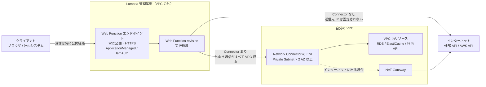
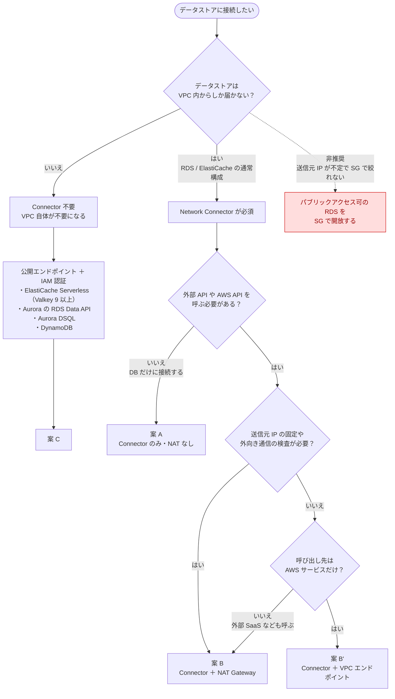
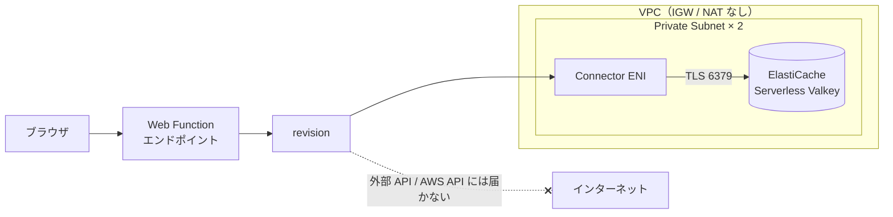
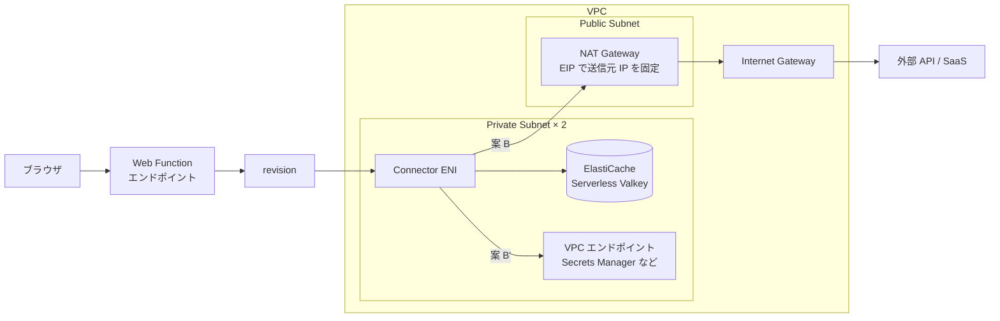
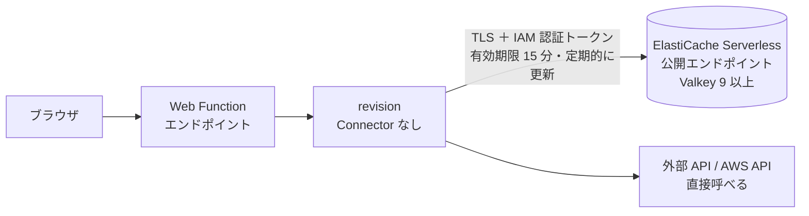
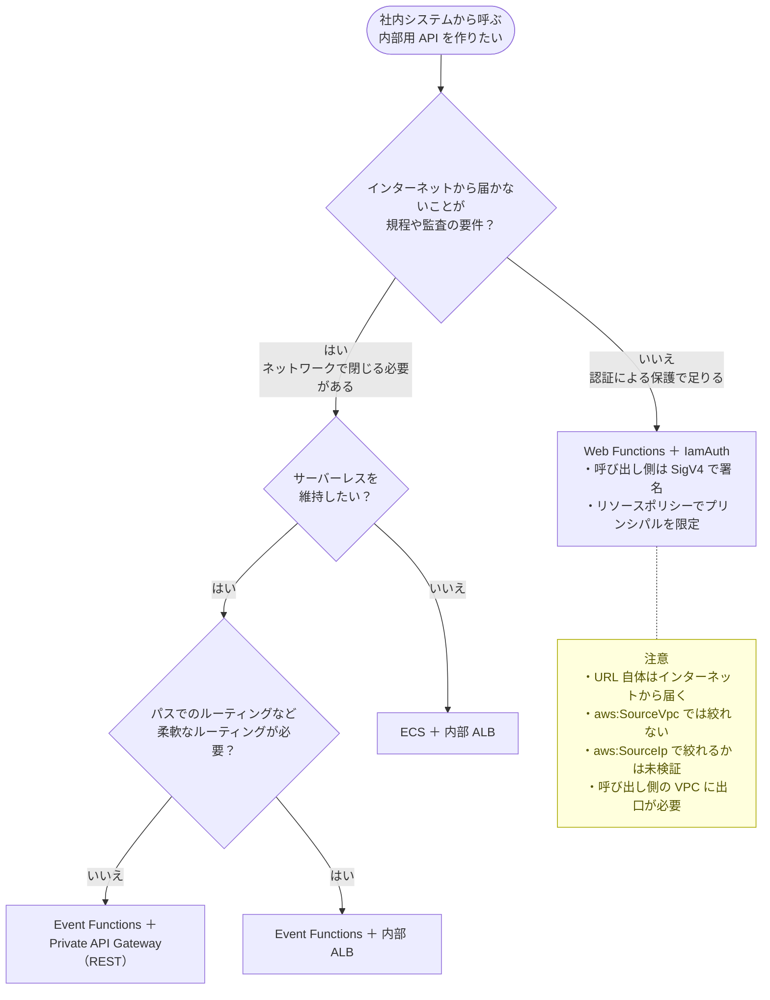
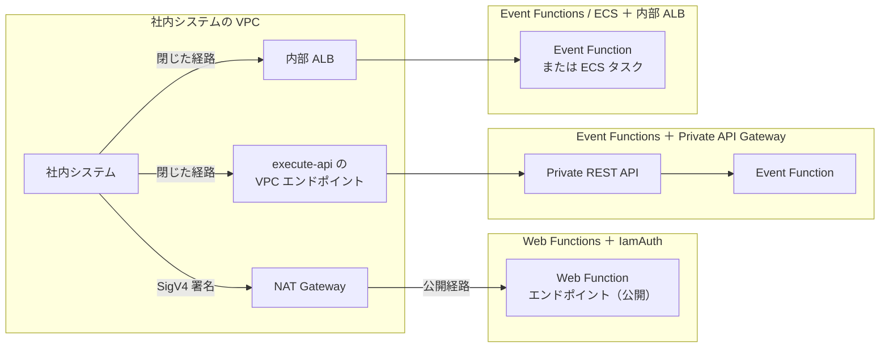

# Lambda Web Functions のネットワーク構成の選択肢

- 作成日: 2026-10-16
- ステータス: 検討中（VPC 構成を採るかどうかは未決定）
- 関連: [設計書](./design.md)

Lambda Web Functions（2026-10-12 GA）を採用する場合のネットワーク構成について、調査で分かったことと選択肢を整理する。

## 1. Web Functions のネットワークモデル（前提）

調査で分かった前提は次のとおり。

- Web Function 本体には Subnet や VPC の設定項目がない。常に Lambda が管理する基盤で動き、VPC の中には置けない
- **受信**は常に、Lambda が管理する公開 HTTPS エンドポイントから入る。PrivateLink には対応していない
  - 認証タイプは `ApplicationManaged`（アプリ側で認証）と `IamAuth`（SigV4 署名が必要）から選ぶ。どちらでもネットワークとしては公開のまま
- **送信**は revision ごとに次のどちらかを選ぶ
  - Connector なし: パブリック IPv4 の宛先に直接出る。送信元 IP は固定されず、VPC 内のリソースには届かない
  - Network Connector あり: **すべての**外向き通信が Connector の ENI を通って VPC に入る。インターネットに出るには NAT Gateway などが必要
- Network Connector を使えるのは `HomeRegion` エンドポイントだけ（マルチリージョンでは使えない）
- 料金ページに Connector 本体の料金の記載はない。Web Functions と VPC の間のデータ転送には、同一リージョン内のデータ転送料金がかかる

## 2. データストアへの接続方式

### 2.1 判断フロー

### 2.2 案 A: Connector のみ（NAT なし）

### 2.3 案 B: Connector ＋ NAT Gateway または VPC エンドポイント

### 2.4 案 C: VPC なし（公開エンドポイント ＋ IAM 認証）

### 2.5 比較

| 観点 | 案 A: Connector のみ | 案 B: Connector ＋ NAT | 案 B': Connector ＋ VPC エンドポイント | 案 C: VPC なし |
| --- | --- | --- | --- | --- |
| データストアの露出 | VPC 内に閉じる | VPC 内に閉じる | VPC 内に閉じる | インターネットから届く（IAM で保護する） |
| 外部 API の呼び出し | できない | できる | AWS サービスだけ | できる |
| 送信元 IP の固定 | 対象外 | できる（EIP） | 対象外 | できない |
| 外向き通信の検査 | 対象外 | できる（Network Firewall など） | 限定的 | できない |
| 月額の固定費（東京・概算） | Valkey のみ | ＋ NAT 約 45 USD × AZ 数 ＋ 通信量 | ＋ 約 10 USD × エンドポイント数 × AZ 数 | Valkey のみ |
| 構成の複雑さ | 中 | 高 | 中〜高 | 低 |
| アプリの実装 | 標準的 | 標準的 | 標準的 | IAM トークンの更新処理が必要 |
| マルチリージョン | 使えない | 使えない | 使えない | 使える |
| 向いている場面 | デモ、DB だけに接続するアプリ | 規程・監査で求められる本番 | AWS サービスとだけ連携する本番 | インフラを持たない利点を最大化したい場合 |

## 3. 社内向けの内部用 API の構成

Web Functions は受信を Private にできない。社内システムから呼ぶ API の場合、「ネットワークで閉じる必要があるか」で構成が分かれる。

### 3.1 判断フロー

### 3.2 構成

### 3.3 比較

| 観点 | Web Functions ＋ IamAuth | Event Functions ＋ Private API Gateway | Event Functions ＋ 内部 ALB | ECS ＋ 内部 ALB |
| --- | --- | --- | --- | --- |
| 受信経路 | 公開（認証で保護する） | 閉じている | 閉じている | 閉じている |
| VPC や VPC エンドポイントで制限 | できない | できる（リソースポリシー） | SG で制限する | SG で制限する |
| 呼び出し側の実装 | SigV4 署名が必須 | 通常の HTTP（IAM 認証にもできる） | 通常の HTTP | 通常の HTTP |
| 固定費（概算） | ほぼなし（呼び出し側に NAT がなければ必要） | VPC エンドポイント約 10 USD × AZ 数 | ALB 約 20 USD〜 | ALB ＋ タスク ＋ NAT |
| フレームワークの扱い | Express や Next.js をそのまま動かせる | Event Functions 用のハンドラかアダプタが必要 | 同左 | そのまま動かせる |

## 4. 今回の TODO アプリでの扱い

- 決定事項: リージョンは東京、外部から誰でもアクセスできる → 受信は Web Functions の公開エンドポイントで問題ない
- 未決定: データストアへの接続方式（2 章の案 A / B / C）
  - 判断材料: 想定する本番で、送信元 IP の固定が必要か、外向き通信の検査や閉域が規程で求められるか、データストアをインターネットから届く場所に置いてよいか
  - 検証案: 案 A を土台に作り、NAT を Terraform の変数で後から足せる形にして、疎通、コールドスタート、費用を実測で比べる。案 C を比較対象に加えるかどうかは、上の判断材料の答え次第
- 内部用 API（3 章）を今回の検証範囲に入れるかどうかは未定

## 参考

- [Configuring networking for AWS Lambda Web Functions](https://docs.aws.amazon.com/lambda/latest/dg/web-functions-networking.html)
- [Lambda Web Function endpoint access control](https://docs.aws.amazon.com/lambda/latest/dg/web-functions-endpoint-access-control.html)
- [CreateNetworkConnector API](https://docs.aws.amazon.com/lambda/latest/lambda-core/API_CreateNetworkConnector.html)
- [AWS Lambda Pricing](https://aws.amazon.com/lambda/pricing/)
- [Amazon ElastiCache FAQs](https://aws.amazon.com/elasticache/faqs/)
