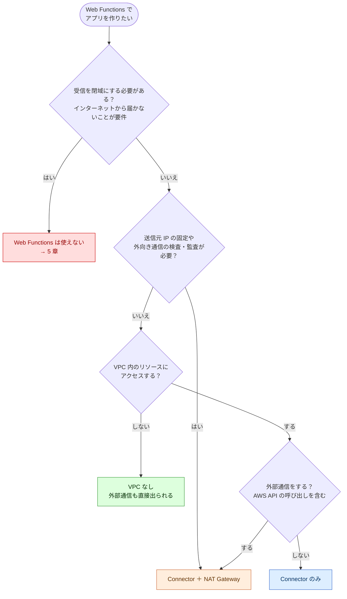
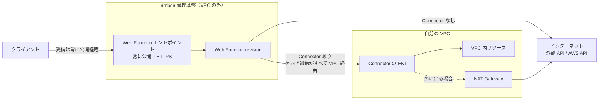
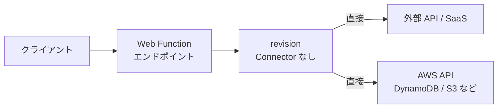
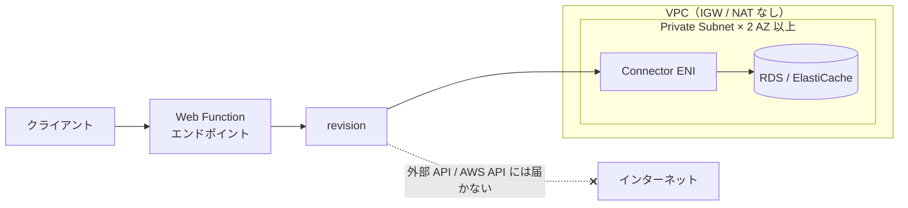
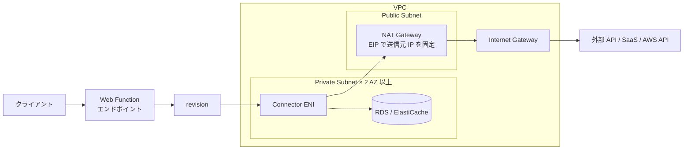
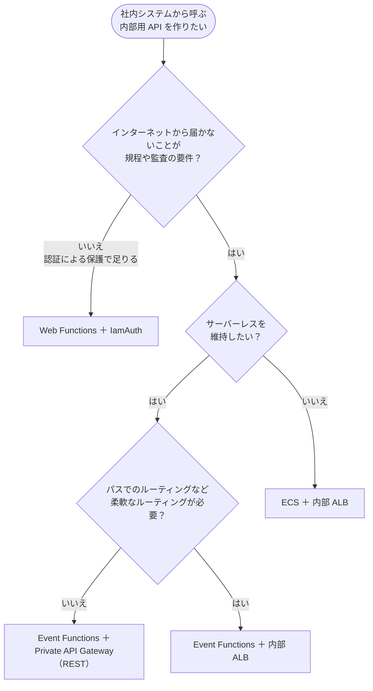

# Lambda Web Functions のネットワーク構成の選択肢

- 作成日: 2026-10-16
- ステータス: 検討中
- 関連: [設計書](./design.md)

Lambda Web Functions（2026-10-12 GA）を採用するときのネットワーク構成を、調査結果をもとに整理する。

## 1. 結論: 構成の分岐は 2 つの軸で決まる

前提として、Web Functions は**受信を閉域にできない**。それを受け入れたうえで、構成は次の 2 軸で決まる。

1. **VPC 内のリソースにアクセスしたいか**（RDS、ElastiCache、社内 API、Direct Connect / VPN の先のオンプレミスなど）
2. **外部通信をしたいか**（外部 API や SaaS に加え、Connector を使う場合は AWS API の呼び出しも含む）

| VPC 内のリソースにアクセス | 外部通信 | 構成 |
| --- | --- | --- |
| しない | しない | VPC なし |
| しない | する | VPC なし（直接出られる） |
| する | しない | Connector のみ |
| する | する | Connector ＋ NAT Gateway |

**追加の条件:** 外向き通信の送信元 IP の固定や、通信の検査・監査が必要な場合は、上の表にかかわらず **Connector ＋ NAT Gateway** になる。VPC 内のリソースにアクセスしない場合でも、通信を VPC に通すためだけに Connector と VPC を用意する。

## 2. 前提となる Web Functions のネットワークモデル

- Web Function 本体には Subnet や VPC の設定項目がない。常に Lambda が管理する基盤で動き、VPC の中には置けない
- **受信**は常に、Lambda が管理する公開 HTTPS エンドポイントから入る。PrivateLink には対応していない
  - 認証タイプは `ApplicationManaged`（アプリ側で認証）と `IamAuth`（SigV4 署名が必要）から選ぶ。どちらでもネットワークとしては公開のまま
- **送信**は revision ごとに次のどちらかを選ぶ。1 つの revision の中で、宛先ごとに振り分けることはできない
  - Connector なし: パブリック IPv4 の宛先に直接出る。送信元 IP は固定されず、VPC 内のリソースには届かない
  - Network Connector あり: **すべての**外向き通信が Connector の ENI を通って VPC に入る。Connector 自体はインターネットへの出口にならない
- Network Connector を使えるのは `HomeRegion` エンドポイントだけ（マルチリージョンでは使えない）
- 料金ページに Connector 本体の料金の記載はない。Web Functions と VPC の間のデータ転送には、同一リージョン内のデータ転送料金がかかる

## 3. 構成ごとの図

### 3.1 VPC なし

VPC 内のリソースにアクセスしない場合。DynamoDB や S3 のように、もともと VPC の外にあるデータストアはこの構成で使える。

### 3.2 Connector のみ

VPC 内のリソースにアクセスし、外部通信をしない場合。

### 3.3 Connector ＋ NAT Gateway

VPC 内のリソースにアクセスし、外部通信もする場合。または、送信元 IP の固定や監査が必要な場合。

### 3.4 比較

| 観点 | VPC なし | Connector のみ | Connector ＋ NAT Gateway |
| --- | --- | --- | --- |
| VPC 内のリソース | 届かない | 届く | 届く |
| 外部通信 | できる | できない | できる |
| 送信元 IP の固定 | できない | 対象外 | できる（EIP） |
| 外向き通信の検査 | できない | 対象外 | できる（Network Firewall など） |
| 月額の固定費（東京・概算） | なし | なし | NAT 約 45 USD × AZ 数 ＋ 通信量 0.062 USD/GB |
| マルチリージョン | 使える | 使えない | 使えない |

## 4. 補足

### 4.1 見落としやすい外部通信

Connector を使う場合、次の通信も「外部通信」になる。本番のアプリでは、自分で外部 API を呼んでいなくても発生していることが多い。

| 種類 | 例 |
| --- | --- |
| AWS API | Secrets Manager、SSM Parameter Store、S3、SQS など |
| 認証 | OAuth / OIDC（Auth.js など）の IdP のトークンエンドポイント、JWKS の取得 |
| 画像最適化 | `next/image` で外部ドメインの画像を取得する |
| 監視 | Sentry、Datadog、OpenTelemetry のエクスポーター |
| SaaS | Stripe、SendGrid など |

### 4.2 NAT Gateway の代わりになる手段

本番で無理なく選べるのは実質的に NAT Gateway だが、条件によっては次の手段もある。

| 手段 | 使える条件・注意点 |
| --- | --- |
| VPC エンドポイント | 呼び出し先が AWS サービスだけの場合。S3 と DynamoDB は無料のゲートウェイ型、その他はインターフェイス型で 1 本・1 AZ あたり月約 10 USD |
| NAT インスタンス（fck-nat など） | 月数 USD で済む。代わりに、可用性とパッチ適用を自分で面倒を見る |
| IPv6 ＋ Egress-only IGW | DualStack の Connector にする。時間課金はないが、呼び出し先が IPv6 に対応している必要があり、外部 SaaS では対応していないことが多い |

### 4.3 検討したが現実的でない構成

| 構成 | 内容 | 採らない理由 |
| --- | --- | --- |
| データストアを公開エンドポイントに置く | ElastiCache Serverless の公開エンドポイント（Valkey 9 以上、IAM 認証）、Aurora の RDS Data API など。Connector も NAT も不要になる | データストアをインターネットから届く場所に置くことは、業務では実質的に採らない |
| 関数を分ける | Connector なしの関数（画面・外部通信）から、Connector ありの関数（データアクセス API）を `IamAuth` で呼ぶ。NAT は不要 | Next.js などの単一フレームワークのアプリでは、DB アクセスをすべて HTTP API に置き換えることになり、トランザクションも分断される。もともと BFF とバックエンド API に分かれた構成でなければ非現実的 |

関数を分ける構成は、呼び出しの向きが「Connector なし → Connector あり」でしか成り立たない点にも注意する。Connector ありの関数から公開エンドポイントを呼ぶには、NAT が必要になる。

## 5. 受信を閉域にしたい場合（社内向けの内部用 API など）

Web Functions は受信を閉域にできない。認証で保護するだけで足りるかどうかで、構成が分かれる。

| 観点 | Web Functions ＋ IamAuth | Event Functions ＋ Private API Gateway | Event Functions ＋ 内部 ALB | ECS ＋ 内部 ALB |
| --- | --- | --- | --- | --- |
| 受信経路 | 公開（認証で保護する） | 閉じている | 閉じている | 閉じている |
| VPC や VPC エンドポイントで制限 | できない | できる（リソースポリシー） | SG で制限する | SG で制限する |
| 呼び出し側の実装 | SigV4 署名が必須 | 通常の HTTP（IAM 認証にもできる） | 通常の HTTP | 通常の HTTP |
| 固定費（概算） | ほぼなし（呼び出し側の VPC に出口が必要） | VPC エンドポイント約 10 USD × AZ 数 | ALB 約 20 USD〜 | ALB ＋ タスク ＋ NAT |
| フレームワークの扱い | Express や Next.js をそのまま動かせる | Event Functions 用のハンドラかアダプタが必要 | 同左 | そのまま動かせる |

Web Functions ＋ IamAuth の注意点:

- URL 自体はインターネットから届く
- `aws:SourceVpc` では絞れない（VPC エンドポイントを前提とした条件のため）
- `aws:SourceIp` で絞れるかどうかは未検証（Web Functions 用に記載されている条件キーは、認証タイプとタグだけ）

## 6. 今回の TODO アプリへの当てはめ

| 軸 | TODO アプリ |
| --- | --- |
| 受信の閉域 | 不要（外部から誰でもアクセスできる） |
| VPC 内のリソースへのアクセス | する（ElastiCache for Valkey） |
| 外部通信 | しない |
| IP 固定・監査 | 不要 |

→ **Connector のみ**の構成に当たる。本番を想定するなら、認証や監視を足した時点で外部通信が発生し、Connector ＋ NAT Gateway に移ることになる。そのため、NAT Gateway を Terraform の変数で後から追加できる形で作っておく。

## 参考

- [Configuring networking for AWS Lambda Web Functions](https://docs.aws.amazon.com/lambda/latest/dg/web-functions-networking.html)
- [Lambda Web Function endpoint access control](https://docs.aws.amazon.com/lambda/latest/dg/web-functions-endpoint-access-control.html)
- [CreateNetworkConnector API](https://docs.aws.amazon.com/lambda/latest/lambda-core/API_CreateNetworkConnector.html)
- [AWS Lambda Pricing](https://aws.amazon.com/lambda/pricing/)
- [Amazon ElastiCache FAQs](https://aws.amazon.com/elasticache/faqs/)
